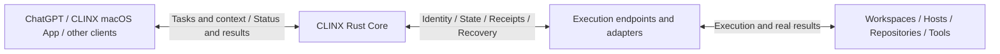

# CLINX

**AI Task Routing & Execution Infrastructure**

**AI 任务路由与执行流通基础设施**

CLINX connects AI clients, coding agents and execution environments. It routes
tasks, instructions and context to the correct execution endpoint with low
latency, and reliably returns real execution status and results. Accurate
delivery, fast flow, reliable receipts and bidirectional communication are its
core mission. See the [product positioning and responsibility boundaries](docs/PRODUCT_POSITIONING.md).

CLINX owns task identity, routing, delivery correlation, idempotency and recovery.
Coding agents and their environments perform the business work; upstream and
downstream components own their business permissions, credentials and safety
policies. CLINX adds no separate approval or business-review layer.

For the current native Codex adapter, ordinary tasks use `NATIVE_FULL_ACCESS`
(`dangerFullAccess`, `approvalPolicy=never`), without writable-root lists or
network restrictions. See [native runtime configuration](docs/NATIVE_FULL_ACCESS.md).

The only execution configuration is optional `model` and `reasoning_effort`.
Use an exact Codex conversation URI directly: prepare once, then start, without
repeated searches, policy reviews or approval questions.

Task preparation forwards user work to native Codex. Git operation names,
capability lists, and repository targets are task context, not CLINX permission
checks. Codex and the target environment own operation access; CLINX owns task
routing, concurrent execution coordination, and execution records. See the
[task forwarding contract](docs/EXECUTION_AUTHORITY.md#native-task-forwarding-2026-10-17).

Start with the [documentation index](docs/README.md) for repository layout,
current contracts, dated release evidence and recovery boundaries, or the
[script and launcher index](scripts/README.md) for entrypoints and their effects.

It turns a one-off coding-agent interaction into work that can be continued,
recovered, coordinated, and audited without copying a long prompt between
sessions.



Rust Core is the single authoritative entrypoint for CLINX task state, receipts,
recovery and resource lifecycle. Adapters share those contracts; they do not own
competing task state. This defines the architecture boundary; deployed behavior
requires release evidence and current runtime readback.

CLINX is not another AI agent, a code-review platform, a safety-approval system
or a control center deciding what users may do. Linear is an optional audit and
notification projection; its availability must not block normal task flow.

## Why CLINX exists

Agent sessions are useful but naturally ephemeral. Engineering work is not.
The same task may need multiple provider sessions, several agents, a guarded
workspace, real host operations, and an evidence-backed result. CLINX keeps
that work coherent while allowing the execution carrier to change.

- A **Task** is the long-lived engineering identity.
- A provider **thread/session/turn** is a replaceable execution carrier.
- **ConversationBinding** records which verified provider conversation is bound
  to the task, including historical adoption and migration lineage.
- Rust execution **leases** fence attempts per task. Independent tasks can share
  a workspace; unknown delivery retains only the affected task's ownership.
- An **Execution** owns one bounded attempt, its exact route, evidence, result,
  and terminal lifecycle.
- **Execution finalization** commits terminal state through the same core
  authority; provider events and host evidence are inputs, not competing owners
  or a separate business-acceptance layer.

## Current capabilities

The checked-in implementation and test suite currently cover:

- Native Codex task creation and continuation through the configured Desktop
  daemon, with exact input receipts; see [Desktop execution](docs/DESKTOP_NATIVE_EXECUTION.md).
- Durable Task and opaque Execution identities with exact task, turn, route,
  and lease ownership.
- ConversationBinding, bounded historical conversation adoption, and
  provider-thread migration with predecessor/successor lineage.
- Per-task Rust leases, stale-lease reconciliation, cancellation, and
  fail-closed routing checks.
- Internal legacy Host execution and receipt reconciliation. Host capability
  tools are not part of the public native-forwarding catalog.
- Provider terminal/failure reconciliation, exact host evidence, strict
  result parsing, and finalization that releases the execution lease.
- Idempotent result attribution and Linear audit binding without allowing
  Linear to own execution state.
- An MCP prepare/start flow with opaque execution references. The user's task
  instruction supplies authorization; the normal public catalog does not expose
  a generic `clinx_execute`.
- Versioned execution contracts, runtime ownership and Rust qualification work.
  Source, isolated qualification and installed releases have separate evidence;
  see the [release record index](docs/README.md#发布与回退记录).

These are self-hosted and dogfooded capabilities, not a claim of production
readiness. Runtime/provider behavior must still be qualified in the deployment
environment rather than inferred from unit tests alone.

## Core model

```text
Task (long-lived identity)
  ├── ConversationBinding (verified provider conversation)
  ├── Execution (one bounded attempt)
  │     ├── Per-task execution lease
  │     ├── Provider turn
  │     ├── Host execution evidence
  │     └── Execution result
  └── Linear task index (audit projection)
```

Lifecycle stages share one task-state authority:

```text
provider event + host evidence
            ↓
  CLINX core finalization
            ↓
 durable result → terminal state → lease release → audit projection
```

CLINX reports the actual execution state and preserves conflicting or unknown
observations. A disconnect or lost ACK alone does not establish business failure
or permit replay. Result attribution uses the exact execution identity, never a
task's latest result or another historical execution. Delivery, execution,
receipt and result readback are distinct states; execution completion does not
establish business acceptance.

## Interoperability direction

CLINX is not tied to Codex. Codex is the current primary provider and adapter.
The long-term direction is a stable CLINX core with adapters for ChatGPT,
Claude Code, Cursor, OpenCode, CI/automation, and custom agents.

Different agents should coordinate around the same authoritative Task and
Execution state, rather than duplicating a conversation-sized prompt. Those
additional provider adapters and broader deployment integrations are roadmap
direction, not universal capabilities claimed by this repository today.

## Design principles

- Keep normal task flow short and free of unnecessary checks.
- Correlate task, session, execution and receipt identities accurately.
- Minimize latency, overhead and intermediate components.
- Recover the original execution through real state readback after lost ACKs,
  disconnects or restarts; avoid duplicate execution.
- Give each authoritative responsibility one implementation and reuse existing
  state, receipt and recovery mechanisms.

Measure delivery success and latency, correlation accuracy, recovery success,
duplicate execution or business submissions, competing state writers, and
adapter maintenance cost. Code volume, test count, approval layers and the
proportion of Rust files do not establish product quality.

## Nearby devices (Local Discovery v1)

The optional `bin/clinx` launcher opens `devices` by default. It browses private
LAN nodes, shows persistent device trust, and authenticates known peers with
mutual TLS. Existing local/SSH provider and manual host paths remain available.

Production pairing requires the native RFC 9807 OPAQUE adapter; it fails closed
when that adapter is unavailable. The separate SPAKE2 backend is explicitly
`DEV_ONLY` and requires `--allow-dev-pairing`; device trust grants no execution
authority. See [Local Discovery v1](docs/LOCAL_DISCOVERY_V1.md) for native build
instructions, isolated setup, the two-device flow and the limits of recorded
acceptance.

## Development and tests

The pytest suite is kept locally in the ignored `tests/` directory and is not
distributed through Git. A fresh GitHub clone contains runtime sources and the
development dependency declarations, but not this local suite. If the retained
local `tests/` directory is available, use Python 3.12 and the commands below.
No production service, API key or Codex daemon is needed for these Rust adapter fixtures:

```sh
python3.12 -m venv .venv-test
.venv-test/bin/python -m pip install -r requirements-dev.txt
.venv-test/bin/python -B -m pytest -c tests/pytest.ini tests/test_rust_native_routing.py tests/test_rust_request_contract.py
.venv-test/bin/python tests/run_tests.py collect
```

If your distribution omits ensurepip, use `uv venv --python 3.12 --seed .venv-test`
for the first command. See [CONTRIBUTING](CONTRIBUTING.md) for workflow and layout,
[Testing](docs/TESTING.md) for isolated Owner/Rust, SQLite, native pairing and
platform prerequisites, and the local `tests/README.md` index for retained suites.
On P620 put developer environments and build outputs in your task-owned LAB path.
The retained local `basic`, `owner` and `recovery` profiles still include tests of
retired Python experiments. Full collection currently reports nine import errors;
see the [phase 2 cleanup record](docs/cleanup/RUST_MIGRATION_CLEANUP_PHASE2.md) for
the exact impact and preserved baseline failures.

## Getting started


Runtime requirements: macOS or Linux, Python 3.11+, Git, a configured Codex
app-server/proxy transport, Linear MCP for the bridge workflow, and a Linear
personal API key. The legacy bridge has no required Python packages; optional device discovery uses
`requirements-discovery.txt`.

`bridge.toml` records the existing operator deployment. Configure your own local
paths, project identities, Provider transport and private registry before running
these service commands. Offline development tests above supply their own state.

Start the bounded MCP adapter locally:

```bash
python3 mcp_server.py --config bridge.toml --stdio
```

For the existing deployment configuration, first run the repository doctor:

```bash
python3 bridge.py --config bridge.toml doctor
```

The bridge reads `LINEAR_API_KEY` from the process environment. Do not put the
key in this repository or in `bridge.toml`.

After the selected project identity and app-server transport are configured,
run one polling cycle:

```bash
python3 bridge.py --config bridge.toml once
```

Use the continuous loop only when the deployment is intentionally operated as
a local service:

```bash
python3 bridge.py --config bridge.toml run
```

Task discovery and context reads are bounded and do not start a provider turn.
Execution uses the preparation/start flow authorized by the user's task request;
private thread,
session, turn, cwd, repository-origin, and credential values remain internal
registry data.

## Boundaries and status

CLINX currently supports local or explicitly configured SSH-stdio provider
transport. This repository does not publish an unauthenticated HTTP/MCP endpoint. The optional
LAN listener only enrolls and authenticates device identities; remote MCP execution
still requires the existing authenticated deployment boundary and authorization.

CLINX routes the user's authorized task to Codex and records its receipts.
That task may include Git or deployment work; the target execution environment
owns those operations. Legacy Host executor checks apply to that separate
internal path, not as extra admission checks for ordinary native forwarding.

Status: actively developed, self-hosted, and dogfooded. Production deployment,
provider interoperability beyond the current adapter, and broader autonomous
operation remain qualification and roadmap work.

P620 uses one canonical development repository. See
[project convergence and historical recovery](docs/PROJECT_CONVERGENCE.md)
for the workspace lifecycle and recovery evidence.
