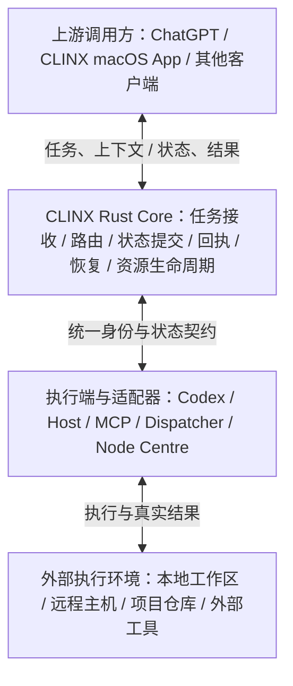

# CLINX 产品定位与职责边界

产品定位基准：2026-10-24（Asia/Shanghai）。本文定义 CLINX 的产品方向、架构职责和
设计取舍；实现与部署状态以对应源码、发布记录和运行读回为准，不从产品定义推导。

**CLINX — AI Task Routing & Execution Infrastructure**

**AI 任务路由与执行流通基础设施**

CLINX 连接 AI 客户端、Coding Agent 与执行环境，让任务和信息准确、快速、可靠地
到达目标执行端，并将真实执行结果送回调用方。它负责传递和管理执行过程，
业务工作由目标 Agent 及其执行环境完成。

| 核心使命 | 含义 |
| --- | --- |
| 准确送达 | 将任务、指令、上下文和事件送到指定执行端。 |
| 快速流通 | 降低延迟、减少中间环节，不增加无意义的流程。 |
| 可靠交付 | 明确区分送达、执行、回执和结果读取状态。 |
| 双向流通 | 既发送任务，也向上游返回执行状态、真实结果和必要事件。 |

## 应该负责什么

| 职责 | 定义 |
| --- | --- |
| 任务接收 | 接收来自 ChatGPT、CLINX macOS App 及其他上游的任务与上下文。 |
| 目标路由 | 将任务准确路由到指定的 Coding Agent、执行会话、主机和项目。 |
| 任务投递 | 将指令、参数和必要上下文传送给目标执行端。 |
| 执行关联 | 准确关联任务、执行实例与原生 Agent 会话，避免串任务、串回执。 |
| 状态与回执 | 记录投递结果，读取执行状态，返回真实的完成、失败或未知状态。 |
| 交付恢复 | 处理重复请求、ACK 丢失、连接中断、结果读回和执行端恢复，避免因通信不确定而重复执行。 |
| 双向消息流 | 将日志摘要、执行结果、错误和必要事件传回调用方。 |
| 多执行端协调 | 支持不同 Agent、主机和项目之间的任务流转。 |

例如，用户要求 Codex 修改 Rust 代码，CLINX 将任务和上下文送到正确的 Codex
会话，并准确返回结果。代码分析、实现、编译和测试由 Codex 及其执行环境完成。
CLINX 记录和转交结果，不替 Codex 完成工作，也不另做一次代码审查或业务验收。

## 不应该负责什么

- 不建立额外审批体系：不自行增加 witness、人工批准层、复杂授权流程或重复资格审查。
- 不替上下游决定安全策略：业务权限、凭据和安全约束由对应的上游、下游工具及执行环境负责。
- 不干预业务决策：不擅自修改用户指令、策略参数、代码实现或业务结果。
- 不把传输问题升级为业务阻塞：可选检查、历史记录或外部服务不可用，不应无故阻断其他正常任务流。
- 不重复建设已有能力：同一权威职责不增加第二个 Owner、第二套权威状态数据库、
  第二套回执系统或另一层控制面。适配器和只读投影不成为竞争权威。
- 不伪造确定性：结果未知就返回未知；通信不确定不能直接等同于业务失败，
  也不能成为无限增加流程或盲目重发的理由。

任务身份、投递关联、幂等和状态准确性是 CLINX 自身的基础设施职责。
必要的协议校验和状态契约服务于这些职责，不扩展为业务安全审批。
无法确认目标或执行关联时，应明确返回该任务的具体问题，不能错误投递或伪造回执。
投递成功不等于执行完成，执行完成也不自动等于业务验收通过。

## 架构分层与唯一权威

Rust Core 是 CLINX 自身任务状态与执行流通的唯一权威状态入口，负责状态提交、
回执、恢复和资源生命周期。终态提交属于这一权威职责，不另设一个竞争的终态 Owner。
它不承担替用户编写代码的 Agent 职责。

执行端可有不同实现，但任务身份、状态提交和回执语义必须一致。Python、Rust、
MCP 和各 Worker 不各自维护互相冲突的事实；适配器传递请求、观察和结果，
通过同一权威入口提交任务状态。只读投影用于展示与集成，不反向决定权威状态。

安全认证、凭据管理、业务授权和执行环境限制由对应上下游组件负责；CLINX
只执行保障准确流通所需的协议和状态契约，不另建一套重复治理体系。
可选投影或外部集成失败不得撤销已经提交的真实结果，也不得无故阻断其他任务。

本分层是职责约束，不表示所有适配器均已实现或所有运行环境均已验收。
Rust 实现和发布证据见 [Rust authority](RUST_AUTHORITY.md)，后续运行操作仍需读回当前状态。

## 五条设计原则

1. **畅通优先**：正常任务以最短路径流通，不增加没有实际价值的检查。
2. **准确优先**：任务、会话、执行实例和回执准确对应，不串联错误。
3. **快速优先**：低延迟、低开销、少中间环节，不为理论上的完美无限叠加组件。
4. **故障可恢复**：连接中断、ACK 丢失或 Agent 重启后，读取真实状态并继续处理，
   不反复创建新任务；发送结果未知时，按原任务与执行身份读回，避免重复执行。
5. **职责单一**：每项权威职责只有一个实现，复用现有状态、回执和恢复机制。

新增机制应能说明它解决了哪一个实际流通问题，以及现有机制为何不能承担。
设计取舍围绕送达、关联、延迟和恢复的实际效果，不以增加审批环节作为质量证明。

## 如何衡量效果

| 指标 | 观察内容 |
| --- | --- |
| 投递成功率与延迟 | 从上游接收到正确执行端确认接收的比例与耗时，失败和未知分别保留。 |
| 关联准确率 | 任务、执行实例、状态、回执和原生会话是否准确对应，是否发生错投或串回执。 |
| 恢复成功率 | ACK 丢失、连接中断和进程重启后，能否读回真实状态并继续原执行。 |
| 重复执行与重复业务提交 | 重复请求、重连与恢复是否引发重复副作用；无法验证的业务结果保留未知。 |
| 竞争权威 | 是否存在多个可独立提交同一任务状态的 Owner、数据库或控制面。 |
| 适配与维护成本 | 新增执行端或项目所需的适配代码、配置与持续维护成本。 |

测量应注明样本、时间窗口、执行端与观察来源，并保留失败和未知结果。
具体目标值由实际工作负载和测量基线确定；本文不声明已经达到的性能数值。
代码量、测试数量、审批层数量和 Rust 文件占比不能替代上述效果。

CLINX 是 AI 任务的高速公路，不是收费站、审批中心或交通警察。
它让任务畅通、准确地到达，让真实结果可靠地返回；业务决策和安全约束留给上下游，
自身只保留保证任务流通所必需的最小机制。
