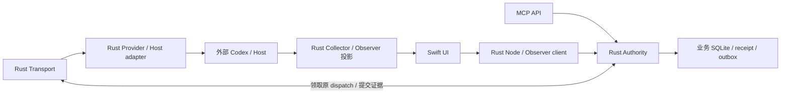

# CLINX 架构与源码布局

用途：当前源码组件、语言归属和发布边界的权威定义。适用范围：Git 源码；不代表运行现场。
状态：CURRENT。验证：[源码分类清单](../architecture/source-policy.json)、Cargo metadata、
`clinx-source-audit --check-project` 和[回归指南](TESTING.md)。

目标和当前源码：**Rust 核心 + 适合客户端的前端技术**。Rust 承担 Task Authority、执行生命周期、
持久化/幂等/恢复、MCP/Provider/Host/Transport、Node/Discovery，以及构建、维护和资格工具。
macOS UI 使用 Swift。受版本控制的 Python 源码已全部退役；没有必须保留的 Python 兼容层。
P620 的特权运维由开发工具 [clinx-admin](../kernel/src/bin/clinx-admin.rs) 承担，
通过既有 Rust 发布/策略/配对契约执行固定操作，不建立第二套业务状态权威。
它独立安装在 root 控制目录，不进入运行 release 或 macOS App；权限入口见
[固定免密运维入口](OPERATIONS.md#p620-固定免密运维入口)。
精确恢复通过同一入口调用单个 Execution 的原 Transport/Authority 契约，不借用普通派发循环。
独立 user Observer 服务与 system Authority/Centre 是不同发布单元，必须分别验证有效入口。
Provider 本机身份以已连接 Unix socket 的内核凭据为准，平台适配使用 Linux
`SO_PEERCRED` / macOS `getpeereid`；稳定路径 alias 与跨设备 mTLS 是不同边界，见[契约](CONTRACTS.md)。
原先低于 5% 的固定源码字节目标继续由 `clinx-source-audit` 验证，不更改统计口径。

源码完成迁移不等于部署完成。已安装服务仍可能使用旧不可变 release；当前迁移不部署、
不重启生产服务、不改生产数据库或真实任务。完整映射、测试及限制见
[Python 源码退役报告](RUST_PYTHON_RETIREMENT.md)。

## 运行职责

| 位置 / 程序 | 职责 |
| --- | --- |
| `kernel/src/business*.rs`、`authority_state.rs`、`clinx-runtime` | 唯一 Task Authority；身份、许可、任务状态、事务、持久化 receipt、幂等和恢复 |
| `clinx-native-transport`、`host_transport.rs`、`host_executor.rs` | native/Host 执行、取消、工具 ACK、进程生命周期和证据回读；通过 Authority 提交事实，不自行写业务数据库 |
| `clinx-mcp` | 业务 MCP、观察 MCP 和显式策略维护 profile；frame、参数校验和精确上下文读取 |
| `clinx-provider` | Codex 协议、Process/SSH/Unix/WebSocket/JSONL、输入证据、精确 thread/turn/history 与 workspace probe |
| `clinx-node`、`clinx-node-daemon` | Node/Centre/Helper、配对 mTLS、反向 Authority 路由、按节点 Provider gateway、Collector/outbox、心跳与重启恢复 |
| `native/opaque_pairing/`、`kernel/src/discovery*` | RFC 9807 OPAQUE、证书/密钥初始化、信任事务、首次配对、DNS-SD、设备 CLI；无 PyO3/解释器/wheel |
| `clinx-observer`、观察模块 | 原生历史只读、观察目录、Collector checkpoint/ACK、HTTP 和监控投影；不是第二套任务权威 |
| `clinx-tunnel`、`clinx-mcp-relay` | 原生 supervisor/health/进程组 drain/持久恢复及透明字节流转发 |
| `MonitorApp/` | Swift macOS UI、App 打包入口与 Helper shell launcher |
| `clinx/mcp/registry.json` | 共享协议数据，由 Rust 编译嵌入；目录已不是 Python 包 |
| `bin/`、`systemd/` | 原生启动器和服务模板；文件存在不代表已安装 |

Helper 正常入口为 `clinx-node-daemon helper`。Mac 通过已配对的 mTLS 到 Centre，再经本地 IPC
访问 Rust Authority；Mac 不使用 Linux Unix peer UID 充当远端身份。Provider 证据按
node/user/project/request/task/execution/thread/turn 精确关联，不能用节点自报成功替代。

prepare/start/cancel、完成/恢复和 metadata outbox 仍由 Authority 原子提交。
未知输入、创建 ACK 或进程结果不盲目重放；恢复读取精确 Provider 历史。
设备注册和观察投影不承担任务 writer fence。任务身份、并行执行、投递、ACK、幂等和恢复契约保持。

`kernel/src/platform.rs` 仅封装 Unix socket 的平台差异，不承担业务状态。Linux 保持原子
`CLOEXEC` / `NONBLOCK`；Darwin 在 socket 返回调用方前设置 `FD_CLOEXEC` / `O_NONBLOCK`。
Authority 时钟在 Linux 保留 `CLOCK_BOOTTIME`，Darwin 使用 `CLOCK_MONOTONIC`；
Mac Provider 的设备号转换必须可表示，否则以 `NATIVE_WRITER_UNPROVEN` 拒绝证明身份。
这些编译适配不改变远端认证、Task writer 或 Air 的执行权限。

`kernel/src/runtime_lab.rs` 的 State 仍由现役 Authority 复用，不能凭名称删除。
旧 Python Bridge/Registry/M9/Owner、completion/recovery/outbox、Monitor factory 和公开兼容包均已删除。

## 开发、构建与维护

| 原生工具 | 用途 |
| --- | --- |
| `clinx-build native-monitor-resources` | 按清单生成 App 资源，移除构建目录中的退役 Python closure |
| `clinx-build stage-rust-release` | 明确二进制名单、hash 与契约 marker，生成候选 release，保持 STAGED_NOT_SELECTED |
| `clinx-build build-transport-runtime` | 固定 SHA 的源/Go 归档，验证依赖并进行两个目录的可复现构建 |
| `clinx-build build-tunnel-release`、`tunnel-cas` | 原生 Tunnel 产物、确定性归档与 rollback capsule；CAS 写操作只接受已有隔离 fixture 契约 |
| `clinx-install provision` / `services` / `callers` | 显式管理员工具；按既有身份边界建立配置和服务定义，只 daemon-reload，不启动服务、不导入历史数据库 |
| `clinx-maintenance transfer-native-session` | 显式会话维护；archive/resume/adopt 前 durable receipt，未知 ACK 不重放 |
| `clinx-diagnostics` | 被动 embedded Bridge 观察和精确 Tunnel health；quiet 不授予 recycle 权限 |
| `clinx-source-audit` | 固定口径源码统计；`--check-structure` 拒绝 Python 重新进入源码或运行依赖 |
| `kernel/tests/`、`kernel/examples/`、`fixtures/` | 已跟踪的 Rust 回归、私有子进程和冻结独立 JSON/SQL oracle；无 Python 测试运行器依赖 |

这些开发工具不进入正常 runtime/App 的显式发布名单。旧 forwarding builder/deployer、
已完成迁移使用的旧 cgroup/旧 Provider-unit 资格与嵌入式 Bridge 实验不再是当前入口；
需要恢复历史操作时使用对应 Git 提交和已保存证据，不能将旧数据库、用户或路径假设套用到新 Authority。

## 发布边界

`architecture/native-runtime.json` 的 Rust release 与 Monitor Python 源码/依赖均为空。
Monitor 只构建、复制并签名三个 Helper：`clinx-provider`、`clinx-node`、`clinx-node-daemon`。
当前 App 没有 Python 解释器、pip 依赖或 OPAQUE wheel。

Rust release 只继承允许的 native `host-worker`（基线 C 降权启动器），使用明确的运行二进制名单和协议数据；
不继承旧 `deps/`、旧 Python 源码或开发维护工具。构建实际探测 Node/daemon/Provider 等契约 marker，
不能只覆盖源码、复用不匹配的旧 binary。安装时使用同 release 的
`clinx-node --compile-config host|mcp` 编译 TOML；运行时不调用 Python 配置解释器。

`architecture/python-sources.json` 全部为 DEAD，保留删除理由和来源路径。
`architecture/module-moves.json` 只保留历史证据映射，没有运行 alias 或新包消费者。
`architecture/runtime-data.json` 声明仍被原生构建使用的 schema 数据。

## 验证与历史证据

当前开发入口见 [贡献指南](../CONTRIBUTING.md) 和 [测试指南](TESTING.md)。
新克隆可以构建并运行已跟踪的 Rust 回归，不依赖本机未提交测试。
原本地 ignored `tests/` 保留原字节；其中 Python 旧 API 导入失败不通过改断言或 skip 消除，
也不算当前原生回归 PASS。各批原参数/断言到 Rust 的映射保留在 `fixtures/*retirement*.json`
与 [退役报告](RUST_PYTHON_RETIREMENT.md)。

Linux 私有进程/mTLS/OpenSSL/DNS wire/数据库测试不替代物理 Mac 跨设备、原生 App 构建签名、
管理员安装或生产切换验收。源码提交、候选产物、选中的 release 和实际进程身份必须分别核对。

## 依赖方向、执行流与遗留边界

这是运行数据流；Rust 同 crate 内有共享类型依赖，不是宣称模块 import 图为单向 DAG。
业务写入只由 Authority 负责；终态、取消和不确定 ACK 语义引用[契约入口](CONTRACTS.md)。
`runtime_lab.rs` 是 Authority 仍复用的状态类型；`lib.rs` 保留旧 evaluator 协议常量，
不能以 `NON_AUTHORITATIVE` 常量推断当前 runtime 不拥有业务库。

直接源码依赖及每份受控代码的角色登记在 `architecture/source-policy.json`。新增文件必须分类，
新增跨模块引用必须更新依赖声明并人工审查。运行库不能导入开发工具、test/example 或 UI；
Swift 只能通过原生 Helper/HTTP/IPC 适配读取或提交请求。SQL 是声明性 schema 数据。

现存 `runtime/host_worker.c` 与 `fixtures/check_transport_profile.go` 是锁定的基线遗留项，
外部 Go Transport 也仍有构建链。它们与“全后端 Rust”目标之间的边界和禁止扩展规则
见 [ADR-007](architecture/ADR-007-rust-source-policy.md)。本轮不进行新的运行迁移。
固定源码百分比只保留历史比较用途，准入要求是零 Python 源码/依赖，而不是低于 5% 即可。

当前配置与服务入口见[配置与运维](OPERATIONS.md)，不从历史报告推断已部署版本。

离线设备路由维护复用原 Store writer 与业务回执链，不创建第二套状态权威。
公开 MCP 不获得全局配置写权；边界见 [ADR-008](architecture/ADR-008-additive-device-routes.md)。
